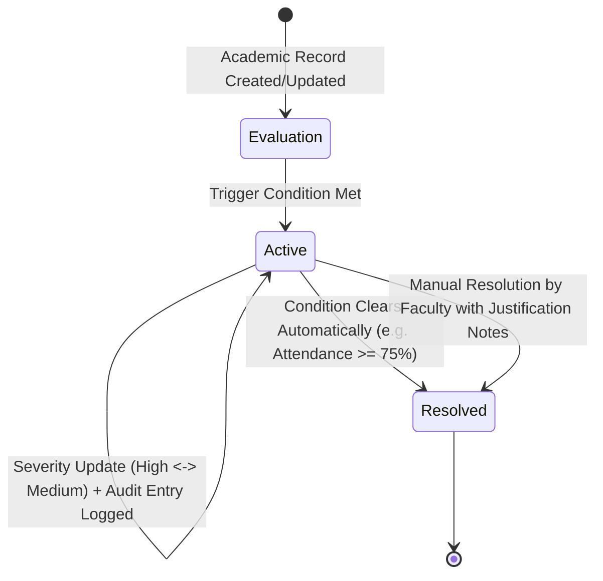

# Student Academic Engagement Monitoring and Parent Communication System (SAEPCS)

A comprehensive full-stack MERN application designed to monitor student academic engagement in real-time, compute academic risk scores, and bridge faculty-parent communication through automated notifications (Email, SMS, and in-app alerts).

---

## 🏗️ Architecture & Project Structure

The project is structured cleanly with separate client and server applications:

```
student-academic-monitoring/
├── client/                               # Frontend React + Vite Application
│   ├── public/
│   ├── src/
│   │   ├── api/                          # Axios instance and API service calls
│   │   ├── components/                   # Reusable UI & role-specific components
│   │   │   ├── common/                   # Navbar, Sidebar, Badges, Notifications
│   │   │   ├── dashboards/               # Admin, Faculty, Student, Parent Dashboards
│   │   │   ├── attendance/               # Attendance recording & matrix
│   │   │   ├── marks/                    # Internal assessment marks
│   │   │   ├── assignments/              # Assignment creation, submission, grading
│   │   │   ├── leaves/                   # Leave applications & approval
│   │   │   ├── risk/                     # Academic risk analytics & alert trigger
│   │   │   └── reports/                  # Analytics charts & jsPDF export
│   │   ├── context/                      # AuthContext for role & session management
│   │   ├── App.jsx                       # Routing & role guard layout
│   │   ├── index.css                     # Tailwind design tokens & glassmorphism
│   │   └── main.jsx                      # React 19 entry point
│   ├── .env.example                      # Client environment variables template
│   ├── .env                              # Local client environment configuration
│   ├── tailwind.config.js                # Tailwind CSS styling tokens & dark palette
│   ├── postcss.config.js                 # PostCSS configuration
│   ├── vite.config.js                    # Vite server & API proxy configuration
│   └── package.json                      # Client dependencies (React, Vite, Tailwind, Chart.js, jsPDF)
│
├── server/                               # Backend Node.js & Express REST API
│   ├── src/
│   │   ├── config/                       # Database connection (MongoDB Atlas / Local)
│   │   │   └── db.js
│   │   ├── controllers/                  # Business logic & request handlers
│   │   │   ├── authController.js         # JWT auth, user registration, role demo-login
│   │   │   ├── studentController.js      # Student CRUD, parent linking
│   │   │   ├── attendanceController.js   # Batch attendance & auto-shortage alerts
│   │   │   ├── marksController.js        # Internal marks & warning alerts
│   │   │   ├── assignmentController.js   # Assignments, submissions, grading
│   │   │   ├── leaveController.js        # Student/parent leave approval flow
│   │   │   ├── riskController.js         # Risk scoring & parent alert trigger
│   │   │   ├── notificationController.js # Multi-channel dispatch & read receipts
│   │   │   └── reportController.js       # Consolidated academic performance reports
│   │   ├── middleware/                   # JWT verification & role authorization
│   │   │   ├── auth.js
│   │   │   └── errorHandler.js
│   │   ├── models/                       # 13 Mongoose models with validation & indexes
│   │   │   ├── User.js                   # Base user, bcrypt hash, role enum, reset token
│   │   │   ├── Student.js                # Roll No, Department, Semester, Parent link
│   │   │   ├── Parent.js                 # Linked student wards, occupation, emergency contact
│   │   │   ├── Faculty.js                # Employee ID, designation, department, subjects
│   │   │   ├── Department.js             # Code, name, description
│   │   │   ├── Subject.js                # Subject code, credits, semester, department
│   │   │   ├── Attendance.js             # Date, status (Present/Absent/Excused), period
│   │   │   ├── InternalMark.js           # Exam type (CIA 1/2, Model), marks, max marks
│   │   │   ├── Assignment.js             # Title, deadline, total marks, subject
│   │   │   ├── AssignmentSubmission.js   # Student submission file, score, feedback
│   │   │   ├── LeaveRequest.js           # Leave dates, reason, status, approvedBy
│   │   │   ├── AcademicRisk.js           # Composite risk score, factors, level
│   │   │   └── Notification.js           # Multi-channel log (email, SMS, in-app)
│   │   ├── routes/                       # Express REST API route definitions
│   │   │   ├── authRoutes.js
│   │   │   ├── studentRoutes.js
│   │   │   ├── attendanceRoutes.js
│   │   │   ├── marksRoutes.js
│   │   │   ├── assignmentRoutes.js
│   │   │   ├── leaveRoutes.js
│   │   │   ├── riskRoutes.js
│   │   │   ├── notificationRoutes.js
│   │   │   └── reportRoutes.js
│   │   ├── services/                     # External services
│   │   │   ├── emailService.js           # Nodemailer with simulation fallback
│   │   │   ├── smsService.js             # Twilio / Fast2SMS gateway with test mode
│   │   │   └── riskAnalysisService.js    # Weighted academic risk calculation
│   │   ├── utils/                        # Database seeders
│   │   │   └── seedData.js               # Initial users for all 4 roles + mock records
│   │   └── server.js                     # Server entry point
│   ├── .env.example                      # Server environment variables template
│   ├── .env                              # Local server environment configuration
│   └── package.json                      # Server dependencies (Express, Mongoose, JWT, etc.)
│
├── package.json                          # Root workspace runner scripts
└── README.md                             # Documentation & Setup Guide
```

---

## ⚡ Tech Stack

| Layer | Technologies |
|---|---|
| **Frontend** | React 19, Vite, Tailwind CSS, Lucide React, Chart.js, react-chartjs-2, jsPDF, Axios |
| **Backend** | Node.js (v24), Express.js, JSON Web Tokens (JWT), Bcrypt.js, Multer, Morgan |
| **Database** | MongoDB Atlas / Local MongoDB via Mongoose ORM |
| **Communication** | Nodemailer (SMTP), Twilio REST API / Fast2SMS / In-app Notifications |

---

## 👥 Supported User Roles

1. **Admin**: System-wide oversight, manage students and faculty, link students with parents, view department-level risk statistics.
2. **Faculty**: Take batch attendance, publish and grade assignments, record internal assessment marks, approve/reject leave requests, and dispatch risk warnings to parents.
3. **Student**: View personalized attendance percentages, assessment scores, upcoming assignment deadlines, submit homework, and apply for leaves.
4. **Parent**: View linked child/children's real-time attendance, internal exam marks, academic risk status, and receive alerts via Email and SMS.

---

## 🚀 Installation & Running the Project

### 1. Prerequisites
- **Node.js**: v18+ (tested on Node v24.13.0)
- **npm**: v9+ (tested on npm 11.6.2)
- **MongoDB**: Local MongoDB instance or free MongoDB Atlas URI

### 2. Environment Setup

#### Backend (`server/.env`):
A default `.env` is already configured for local testing. To connect to MongoDB Atlas or custom email/SMS services, edit `server/.env`:
```env
PORT=5000
MONGODB_URI=mongodb://127.0.0.1:27017/student_academic_monitoring
JWT_SECRET=saepcs_super_secret_jwt_key_2026_academic_monitoring
JWT_EXPIRES_IN=7d
SMTP_HOST=smtp.ethereal.email
SMTP_PORT=587
SMTP_USER=your_email@domain.com
SMTP_PASS=your_email_password
EMAIL_FROM=alerts@academic-monitoring.edu
SMS_PROVIDER=mock
TWILIO_ACCOUNT_SID=AC_your_twilio_sid
TWILIO_AUTH_TOKEN=your_twilio_token
TWILIO_PHONE_NUMBER=+15551234567
CLIENT_URL=http://localhost:5173
```

#### Frontend (`client/.env`):
```env
VITE_API_BASE_URL=http://localhost:5000/api
VITE_APP_NAME="Student Academic Engagement Monitoring & Parent Communication System"
```

---

### 3. Running the Backend Server

Open a terminal and execute:
```bash
cd student-academic-monitoring/server
npm run dev
```
> The backend server will start on **http://localhost:5000**
> Verify health check at **http://localhost:5000/api/health**

---

### 4. Running the Frontend Client

Open a second terminal and execute:
```bash
cd student-academic-monitoring/client
npm run dev
```
> The Vite frontend will start on **http://localhost:5173**

---

### 5. Running Both from Root

From the `student-academic-monitoring` root directory:
```bash
npm run dev:server   # Starts backend server (port 5000)
npm run dev:client   # Starts Vite frontend (port 5173)
```

---

### 6. Automated Verification Tests & Seeding

```bash
# Run all tests from workspace root:
npm test

# Or in the server directory:
cd server
npm test            # Runs all 39 backend, security, and HTTP API tests
npm run test:models # Validates 13 Mongoose models, bcrypt, JWT, and role guards
npm run test:api    # Validates HTTP REST routes, Helmet headers, error responses
npm run seed        # Seeds development database across all 13 collections
```

---

## 🔑 Pre-Configured Demo Accounts (Ready to Test)

The database seed automatically prepares pre-configured demo accounts for all 4 roles:

| Role | Email | Password | Details |
|---|---|---|---|
| **Admin** | `admin@saepcs.edu` | `Password@123` | Full administrative control |
| **Faculty** | `faculty@saepcs.edu` | `Password@123` | Dr. Alan Turing (CSE Department) |
| **Student (On Track)** | `student@saepcs.edu` | `Password@123` | Aarav Sharma (95% attendance, good marks) |
| **Student (At Risk)** | `rohan.patel@saepcs.edu` | `Password@123` | Rohan Patel (62% attendance, academic risk) |
| **Parent** | `parent@saepcs.edu` | `Password@123` | Robert Sharma (Linked to Aarav & Priya) |
| **Parent (At Risk Child)** | `meera.patel@saepcs.edu` | `Password@123` | Meera Patel (Linked to Rohan Patel) |

---

## 🧠 Dedicated Academic Risk Identification Engine

The backend Express application features a dedicated, transparent, rule-based **Academic Risk Identification Engine** (`server/src/services/riskAnalysisService.js`) designed for institutional defensibility and academic review presentations.

> **Why Rule-Based?** Unlike black-box machine learning approaches that can introduce arbitrary bias and are difficult to audit in university environments, this engine employs deterministic, configurable criteria that students, mentors, and administrators can easily verify and understand.

---

### 1. Evaluated Risk Conditions & Multi-Tier Severity Classification

The engine evaluates four distinct academic dimensions against administrator-configured thresholds:

| Condition | Description & Trigger | Severity Classification Rules | Exact Diagnostic Reason Format |
|---|---|---|---|
| **1. Attendance Shortage** | Attendance falls below institutional policy (default: `< 75%`). | • **High**: Attendance `< 65%`<br>• **Medium**: Attendance `65%` to `< 75%`<br>• **Low**: Attendance nearing threshold (`75%` to `< 78%`) | `Attendance rate is critical at X% in [Subject] (Institutional minimum: 75%). Missed Y out of Z total lectures.` |
| **2. Internal Assessment Deficit** | Weighted average in internal tests falls below benchmark (default: `< 50%`). | • **High**: Average `< 40%`<br>• **Medium**: Average `40%` to `< 50%`<br>• **Low**: Borderline (`50%` to `< 55%`) | `Internal assessment average is X% (Passing benchmark: 50%). Failed Y out of Z evaluations.` |
| **3. Missing / Overdue Assignments** | Coursework assignments past their submission deadlines with no submission. Trigger: `Count >= 2`. | • **High**: Overdue count `≥ 3`<br>• **Medium**: Overdue count `≥ 2` (Threshold)<br>• **Low**: Overdue count `= 1` | `Missing Assignments: X assignment(s) are overdue and unsubmitted past deadline (Institutional threshold: 2).` |
| **4. Excessive Approved Leave** | Total approved leaves exceed institutional policy quota (default: `6 days`). *Pending & rejected leaves are excluded.* | • **High**: Approved leave `≥ 10 days` (or 1.5× limit)<br>• **Medium**: Approved leave `≥ 6 days`<br>• **Low**: Approved leave nearing limit (`4 - 5 days`) | `Excessive Approved Leave: Approved leave total has reached X days, exceeding the institutional limit of 6 days.` |

---

### 2. Composite Academic Risk Index Formula

In addition to discrete individual risk records, the engine calculates a consolidated **Composite Risk Index (0–100)**:

$$\text{Risk Score} = 0.40 \times \text{Deficit}_{\text{Attendance}} + 0.30 \times \text{Deficit}_{\text{Marks}} + 0.15 \times \text{Deficit}_{\text{Assignments}} + 0.15 \times \text{Deficit}_{\text{Leave}}$$

Where:
- $\text{Deficit}_{\text{Attendance}} = \max\left(0, \frac{85 - \text{Attendance}\%}{85} \times 100\right)$
- $\text{Deficit}_{\text{Marks}} = \max\left(0, \frac{60 - \text{Marks}\%}{60} \times 100\right)$
- $\text{Deficit}_{\text{Assignments}} = \min\left(100, \frac{\text{MissingCount}}{\text{Threshold}} \times 75\right)$
- $\text{Deficit}_{\text{Leave}} = \min\left(100, \frac{\text{ApprovedLeaveDays}}{\text{PolicyLimit}} \times 75\right)$

**Enforced Severity Ceilings & Floors:**
- If any discrete risk is classified as **High**, the composite score is guaranteed a minimum floor of `65%` to prevent dilution.
- If the highest discrete risk is **Medium**, the score has a minimum floor of `35%`.

---

### 3. Data Model Architecture: `AcademicRisk`

Risk tracking is powered by a dedicated Mongoose schema (`server/src/models/AcademicRisk.js`):

```javascript
{
  student: { type: ObjectId, ref: 'Student', required: true, index: true },
  riskType: { 
    type: String, 
    enum: ['Attendance', 'Assessment Marks', 'Missing Assignments', 'Excessive Leave', 'Composite'] 
  },
  severity: { type: String, enum: ['Low', 'Medium', 'High'], default: 'Low' },
  reason: { type: String, required: true },
  status: { type: String, enum: ['Active', 'Resolved', 'Acknowledged'], default: 'Active' },
  detectedDate: { type: Date, default: Date.now },
  lastEvaluatedDate: { type: Date, default: Date.now },
  resolvedDate: { type: Date },
  resolutionReason: { type: String },
  resolvedBy: { type: ObjectId, ref: 'User' },
  relatedRecord: {
    model: { type: String, enum: ['Subject', 'Assessment', 'Assignment', 'LeaveRequest'] },
    id: { type: ObjectId },
    name: { type: String }
  },
  metricsSnapshot: {
    attendancePercentage: Number,
    marksAveragePercentage: Number,
    missingAssignmentsCount: Number,
    approvedLeaveDays: Number,
    compositeRiskScore: Number
  },
  auditTrail: [{
    action: { type: String, enum: ['DETECTED', 'SEVERITY_CHANGED', 'RE-EVALUATED', 'MANUALLY_RESOLVED', 'CONDITION_RESOLVED'] },
    previousSeverity: String,
    newSeverity: String,
    triggerReason: String,
    performedBy: { type: ObjectId, ref: 'User' },
    notes: String,
    timestamp: { type: Date, default: Date.now }
  }]
}
```

---

### 4. Risk Lifecycle & State Machine



1. **Reactive Re-Evaluation**: Runs automatically whenever:
   - Attendance is marked or excused
   - Internal assessment scores are entered
   - Coursework assignments pass their deadline
   - Student submits an assignment (on-time or late)
   - Leave requests are approved or revoked
   - Administrator modifies institutional risk thresholds
2. **Duplicate Prevention**: Compound indexes on `(student, riskType, status)` ensure that only **one active record** exists per issue at any time. Repeated evaluations update `lastEvaluatedDate` and the snapshot without spamming records.
3. **Automatic Resolution**: When a student's metric recovers past the safe threshold (e.g. missing assignments are submitted, or attendance recovers to $\ge 75\%$), the active risk is cleanly closed, marked `Resolved`, and a `CONDITION_RESOLVED` event is recorded in the audit trail.
4. **Manual Faculty Resolution**: Faculty mentors can manually mark a risk as resolved if justified (e.g., student submitted medical certificate, attended remedial session), storing their user ID and notes.

---

### 5. Faculty At-Risk Student Dashboard (`FacultyAtRiskStudents.jsx`)

The frontend delivers an executive risk management console featuring:
- **Summary Metrics**: Real-time counter cards for Total At-Risk, Critical (High), Moderate (Medium), Low, Active Risks, and Resolved Risks.
- **Search & Multi-Filters**: Instant filter by Severity (`All`, `High`, `Medium`, `Low`), Risk Category (`Attendance`, `Marks`, `Assignments`, `Leave`), and text search by student name or roll number.
- **Dynamic Sorting**: Sort ascending/descending by Composite Risk Score, Attendance %, Marks %, or Missing Assignment count.
- **1-Click Multi-Channel Parent Alert Modal**: Dispatch customized alerts through simulated Email, SMS, and Portal Notifications with a single click.
- **Audit Trail & History Inspector**: Complete chronological drill-down modal showing exact detection timestamps, severity changes, and resolution notes.
- **Direct Resolution Console**: Faculty can enter mentor notes and resolve active risks directly from the interface.

---

---

## 📢 Parent Communication & Multi-Channel Notification System

The system provides an enterprise-grade multi-channel notification engine (`emailService.js`, `smsService.js`, `voiceService.js`, and `notificationService.js`) designed to bridge communication between faculty, parents, and students.

---

### 1. Multi-Channel Notification Architecture

| Channel | Gateway / Provider | Technical Architecture & Implementation | Voice / Cultural Localization |
|---|---|---|---|
| **Email** | Nodemailer with SMTP | • Environment-based SMTP configuration (`SMTP_HOST`, `SMTP_PORT`, `SMTP_USER`, `SMTP_PASS`).<br>• Fallback to simulated test outbox if credentials are omitted.<br>• Rich responsive HTML + plain-text templates.<br>• Includes **Student Name**, **Issue**, **Current Attendance/Marks Metric**, **Recommended Action**, and **Date**.<br>• Automatic retry handling with backoff on temporary network failures. | English |
| **SMS** | Twilio / Fast2SMS / Mock Abstraction | • Modular provider abstraction (`SMSService`).<br>• Dispatches concise alerts ($\le 160$ chars) to verified parent phone numbers.<br>• Logs delivery status (`delivered`, `sent`, `failed`), provider message ID (`SID` / `request_id`), and timestamps.<br>• **Non-breaking error recovery**: Gateway failures never interrupt academic updates or transactions. | English |
| **Voice Playback** | Browser SpeechSynthesis & Gated Voice Gateway | • High-fidelity **Listen** button in Parent and Student Dashboards.<br>• Uses client-side `window.speechSynthesis` API for zero-cost, high-reliability voice playback.<br>• **Indian Language Localization**: Generates short, clear spoken advisories in **Tamil** and **English**.<br>• Tamil greetings include `"வணக்கம்"` and `"Vanakkam"` (`"Vanakkam. Your child has attendance below 75 percent. Please contact the class faculty for further details."`).<br>• **Ethical Disclosure**: Transparently labels audio as client-side speech synthesis; never falsely claims a telephone call was placed.<br>• **Gated Phone-Call Architecture**: Automated voice calling (e.g. Twilio Voice) is strictly gated behind explicit credentials (`TWILIO_VOICE_CALL_ENABLED=true`), phone number verification, and verified parent consent. | **Tamil (`ta-IN`)** & **English (`en-IN`)** |
| **Portal / In-App** | MongoDB Real-Time Notification Log | • Instant real-time alerts stored in MongoDB (`Notification` model).<br>• Multi-channel delivery receipts (`emailSent`, `smsSent`, `voiceDetails`).<br>• Unread counter badge and 1-click "Mark All as Read" action. | English & Tamil Transcripts |

---

### 2. Notification Rules & Anti-Spam Suppression

1. **Trigger on New Risk Detection**: When a student triggers any of the 4 rule-based risk conditions (attendance shortage, low marks, missing assignments, excessive leave), warning alerts are immediately dispatched to both the student and registered parent(s).
2. **Trigger on Severity Changes**: When an existing risk escalates or de-escalates (e.g., from `Medium` to `High` priority), a transition alert is dispatched with updated metrics and recommendations.
3. **24-Hour Duplicate Warning Suppression**: To prevent notification fatigue and message spam, identical unresolved advisories for the same student and condition are suppressed if already sent within a 24-hour window.
4. **Resilient Retry Handling**: Temporary provider transmission failures (network glitches, timeouts) can be retried automatically or via the administrator console (`POST /api/notifications/:id/retry`).
5. **Language Preference**: Parents and students can configure their preferred communication language (`en` or `ta`), which dynamically adjusts voice transcripts and advisory formatting.

---

### 3. Automated Test Suites & Verification (248 Tests, 100% Pass)

The system includes six comprehensive automated test suites (`server/`):

| Test Script | Target Areas Tested | Test Cases | Status |
|---|---|:---:|:---:|
| `test-parent-communication.js` | Email warning templates, SMS provider abstraction, failure recovery, Tamil/English voice TTS messages, consent enforcement, duplicate suppression, retry handling, parent history & admin logs | **61** | **✅ PASS** |
| `test-academic-risk-engine.js` | Dedicated risk engine, 4 conditions, severity rules, duplicate suppression, auto & manual resolution, audit trail, admin threshold APIs, faculty dashboard endpoints | **60** | **✅ PASS** |
| `test-assignments-and-leaves.js` | Assignment creation, on-time & late submissions, faculty grading, leave requests, quota calculation, risk recalculation, duplicate alert suppression | **50** | **✅ PASS** |
| `test-attendance-and-marks.js` | Attendance batch entry, corrections with audit trails, shortage alerts, assessment creation, mark boundaries, role authorization | **36** | **✅ PASS** |
| `test-auth-and-models.js` | 13 Mongoose collections, password hashing, JWT signing, role-based middleware guards | **28** | **✅ PASS** |
| `test-http-api.js` | REST API health, Helmet security headers, rate limiting, 401/403/404 error handlers | **13** | **✅ PASS** |
| **Total** | **Complete Full-Stack Integration** | **248** | **100% PASS** |

Run all tests via:
```bash
cd server
npm test
```
Or run individual test modules:
```bash
node test-parent-communication.js  # 61 tests: Parent communication & notifications
node test-academic-risk-engine.js   # 60 tests: Academic risk engine
node test-assignments-and-leaves.js # 50 tests: Assignments and leave management
node test-attendance-and-marks.js   # 36 tests: Attendance and assessment marks
node test-auth-and-models.js        # 28 tests: Models and authentication
node test-http-api.js               # 13 tests: HTTP security and API routes
```
